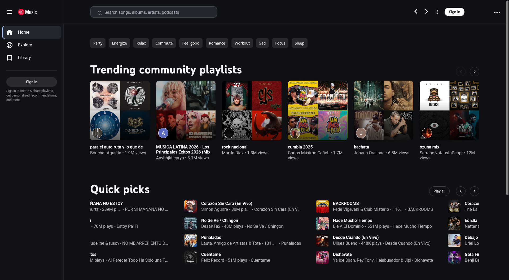
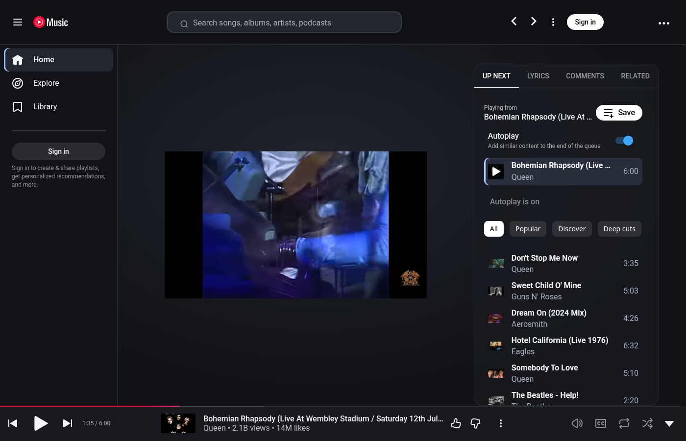

# Pear Dark Theme

A dark theme for [Pear Desktop](https://github.com/pear-devs/pear-desktop).

- Uniform dark backgrounds and rounded artwork
- More space around the queue and lyrics
- Larger seek bar with an always-visible thumb
- Three-dot app menu in the YouTube Music header on Linux

## Screenshots

Home screen with dark backgrounds and rounded artwork:



Player and queue:



Captured on Linux with Pear Desktop 3.12.0, without signing in.

## Install

Requires Python 3 and an existing Pear installation. Open Pear once to create its configuration, then quit it completely before running the installer.

```sh
git clone https://github.com/Insthic/pear-dark-theme.git
cd pear-dark-theme
python3 install.py
```

You can also download and extract the [ZIP](https://github.com/Insthic/pear-dark-theme/archive/refs/heads/main.zip). On Windows, use `py install.py`.

Reopen Pear after installation.

### Installer options

Check the destination without making changes:

```sh
python3 install.py --dry-run
```

Use a custom profile directory:

```sh
python3 install.py --config-dir "/path/to/YouTube Music"
```

The installer backs up your configuration and registers the CSS files. It disables Album Color Theme, Ambient Mode, Blur Navigation Bar, Visualizer, and Synced Lyrics. On Linux, it enables In-App Menu and hides the separate title bar. Other profile settings are preserved.

Existing theme entries named `pear-dark.css` or `progress-bar.css` are replaced. Unrelated themes stay enabled and may override these styles.

## Compatibility

Tested with Pear Desktop 3.12.0 on Linux. Windows and macOS are untested; menu integration is Linux-only.

The seek bar styles target YouTube Music's newer miniplayer. Changes to YouTube Music may require selector updates.

## Uninstall

Close Pear and restore `config.json` from the latest backup under `pear-dark-backups` in your profile directory. Then reopen Pear.

## License

[MIT](LICENSE). See [PRIVACY.md](PRIVACY.md) for details about local configuration and backups.
